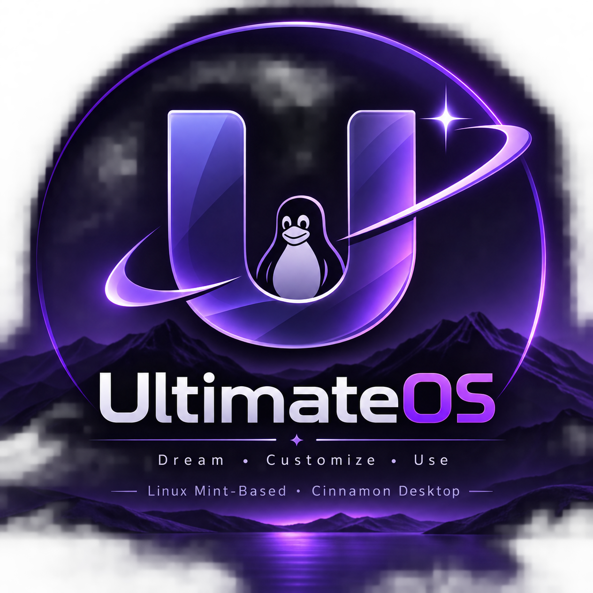
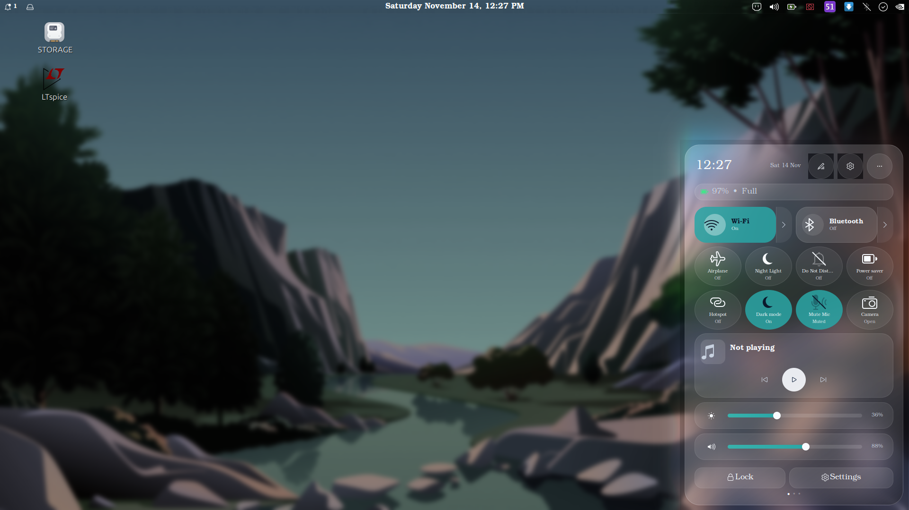
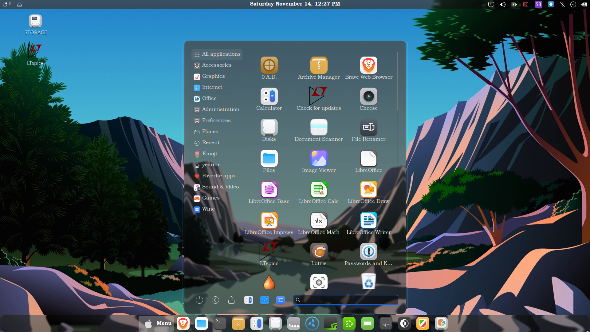
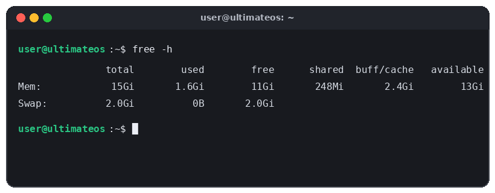

# UltimateOS (Linux Mint 22.3 Edition)

<p align="center">
  
</p>

<p align="center"><strong>Dream • Customize • Use</strong></p>

UltimateOS is a customized desktop distribution based on **Linux Mint 22.3 (Zena), Ubuntu 24.04 LTS base, and Cinnamon**. The project keeps Mint as its underlying operating system and adds a distinct desktop experience: a ColorOS-inspired GTK Quick Settings panel, a streamlined Cinnamon layout, WhiteSur styling, Neon Penguin boot branding, Brave Browser, AI web shortcuts, and hardware-discovery utilities.

> **Project scope:** UltimateOS is a Linux Mint-based remaster/customization project. It is not a new Linux kernel or an independently maintained Linux distribution base. Core operating-system packages and updates continue to come from the Mint/Ubuntu ecosystem.

---

## Screenshots

| ColorOS-inspired Quick Settings | Desktop, app menu and window controls |
| :---: | :---: |
|  |  |

---

## Main features

### Cinnamon desktop and visual identity
- ColorOS-inspired translucent dark-glass Quick Settings panel with teal `#2aa6a6` active-state accents.
- Streamlined Cinnamon top panel, Cinnamenu, BlurCinnamon, WhiteSur themes/icons and curated wallpaper.
- Custom Neon Penguin Plymouth boot branding.
- Cinnamon configuration is applied through the repository's dconf/configuration files.

### Quick Settings control center
- GTK3 application with Wi-Fi and Bluetooth drawers.
- Uses existing Linux services and utilities, including NetworkManager/`nmcli`, BlueZ/`bluetoothctl`, `rfkill`, PipeWire/`wpctl`, `brightnessctl`, `playerctl` and UPower.
- Audio and brightness sliders, media controls, Night Light and system toggles.
- Additional actions include Power Saver, microphone mute, camera launcher, Airplane Mode, Do Not Disturb and Dark Mode.

The panel is a desktop control interface; the underlying system services remain responsible for networking, audio, power and device operation.

### Browser and AI shortcuts
- Brave Browser is installed from its official APT repository by the installer; the installer also removes the pre-installed Firefox packages.
- The AI launcher opens the selected service in the browser: Gemini, ChatGPT or Claude.
- Cinnamon keybindings are configured for the Copilot-key event and modifier combinations. The actual key event depends on how a laptop's firmware and Linux input stack expose that key; fallback key symbols are configured for supported mappings.

**AI integration note:** The Standard Edition launches cloud AI websites. It does not bundle or run a local language model, and using a cloud service is subject to that provider's account, network, privacy and data-handling policies.

### Hardware Fan & RGB Advisor
- Reads local DMI/SMBIOS system-vendor and model information to identify a likely laptop or desktop profile.
- Downloads the public hardware profile database from this repository and recommends a relevant third-party Linux fan/RGB project.
- The database includes model patterns for Acer, HP, Lenovo, ASUS, Dell, MSI and other vendors, plus generic laptop/desktop fallbacks.
- The advisor is a **discovery/recommendation utility**. It does not itself control fans, write to the embedded controller, install the recommended third-party project or guarantee compatibility.

**Third-party hardware disclaimer:** Recommended projects are maintained independently. Check their documentation and model support before installing or using them. Fan and embedded-controller tools can affect thermals and hardware behavior; use them only when you understand the risks.

### Lean first-boot setup
The first-boot optional-software wizard is skipped in a Casper Live session. On an installed system it can offer optional installation of:
- **Gaming & Windows compatibility:** Wine and Winetricks.
- **Office suite:** LibreOffice.

These packages are optional so the base installation can remain lean. They can also be installed later through the package manager.

---

## Tested environments and performance

The project README's recorded tests are:

| Environment | Configuration | Recorded idle memory |
| :--- | :--- | :---: |
| Primary laptop | Acer ALG AL15G-53; Intel Core i5-13420H; NVIDIA RTX 3050 Mobile 4 GB; 16 GB DDR4 | ~1.6 GiB |
| QEMU/KVM Live session | x86_64 virtual machine, BIOS/UEFI boot | ~1.6–1.8 GiB |

The laptop measurement was recorded with the desktop and Quick Settings active. The VM measurement was recorded in a Live session. These are observed measurements, not guaranteed values or minimum hardware requirements; memory use varies with drivers, services, display configuration and running applications.

<p align="center">
  
</p>

### Suggested system requirements

| Component | Suggested baseline | More comfortable |
| :--- | :--- | :--- |
| CPU | 64-bit x86_64 dual-core | Modern quad-core Intel/AMD |
| RAM | 4 GB | 8 GB or more |
| Storage | 25 GB free | 50 GB+ SSD |
| Graphics | Mint-supported graphics, 1024×768 display | Hardware-accelerated GPU |

The recorded ~1.6 GiB idle result should not be interpreted as a 2 GB system requirement: additional memory is needed for applications and normal workloads.

---

## Download

Download the published ISO and its accompanying files from the [UltimateOS Releases page](https://github.com/iyeanur6-cyber/UltimateOS/releases).

The v1.1.0 release notes describe the 3.01 GiB ISO as split across two ZIP parts because of GitHub's per-file release upload limit. Download every part and the checksum file into the same directory before reconstructing the archive. Follow the filenames and reconstruction instructions published with that release; do not rename or omit one of the parts.

After extracting the ISO, verify it against the SHA-256 checksum supplied for that release:

```bash
sha256sum -c UltimateOS-22.3-amd64-sha256.txt
```

The checksum command must be run from the directory containing both the ISO and the checksum file. A successful verification reports `OK`. If the checksum file uses a different filename or references a different ISO filename, use the exact names shown inside that file.

---

## Installation

1. Back up important files and review the installer before running it.
2. Download or clone this repository and open a terminal in the repository root.
3. Run the installer as your normal desktop user:

   ```bash
   bash install.sh
   ```

The script requests administrative privileges for system-level package and file operations. It installs the Quick Settings dependencies and Brave Browser when needed, removes Firefox packages, deploys the Quick Settings application, applies Cinnamon configuration, installs the AI launcher and hardware advisor, and adds the optional-software first-boot entry.

> **Important:** The installer changes system packages and Cinnamon/user configuration. It also modifies the installed Mint Welcome Python file to add the Hardware Advisor entry. Review `install.sh` before execution, make a backup, and run it only on a supported/test system. The repository does not currently provide a full transactional rollback installer.

For a clean evaluation, use the published Live ISO in a virtual machine first. Hardware-specific features should be tested on the target machine before relying on them.

---

## Project layout

```text
UltimateOS/
├── assets/                  # Screenshots and project visuals
├── bin/                     # Quick Settings, AI launcher and hardware advisor commands
├── cinnamon-configs/        # Cinnamon-related configuration assets
├── configs/                 # Keybindings and hardware profile database
├── icons/
├── local-cinnamon/
├── quick-settings-coloros/  # GTK3 Quick Settings application
├── themes/
├── wallpaper/
├── install.sh               # System and user configuration installer
├── cinnamon-dconf.ini
├── cinnamon-full.ini
├── full-desktop-dconf.ini
├── extra-apps.txt
├── keybindings.ini
└── README.md
```

Some generated ISO/build assets may be maintained separately from the desktop application sources.

---

## Standard Edition status and roadmap

### Implemented in the current Standard Edition source
- Linux Mint 22.3 Cinnamon base and custom desktop configuration.
- ColorOS-inspired Quick Settings GTK3 application.
- WhiteSur visual styling, Cinnamenu, BlurCinnamon and custom boot branding.
- Brave Browser installation path.
- Browser-based Gemini, ChatGPT and Claude launcher with Cinnamon keybindings.
- Optional first-boot installation choices for Wine/Winetricks and LibreOffice.
- Hardware Fan & RGB Advisor with a repository-hosted hardware matching database.

### Remaining polish / validation
- Broader hardware testing for the Quick Settings backends and keyboard-key event mappings.
- Consistent client-side decoration/window-button behavior across GTK, CSD and Flatpak applications.
- Live-session tray visibility and panel behavior across different display/VM configurations.
- More robust installer preflight checks, backup/rollback behavior and error reporting.
- Continued verification of third-party hardware database recommendations and model-specific compatibility.

### Longer-term editions

1. **UltimateOS Standard** — lightweight desktop with browser-based AI shortcuts and optional compatibility/office packages.
2. **UltimateOS AI Lite** — planned hybrid local/cloud AI edition, with explicit user control over what information is shared with cloud services.
3. **UltimateOS AI Pro** — planned workstation edition for local LLM workflows, with documented VRAM/RAM tiers and optional cloud fallback.

AI Lite and AI Pro are roadmap concepts, not capabilities delivered by the Standard Edition described here. Privacy boundaries and local-model behavior must be implemented and tested before those editions can make stronger guarantees.

---

## Compatibility and support

- Primary target: Linux Mint 22.3 Cinnamon.
- The project relies on Mint/Cinnamon, GTK3, dconf and standard Linux service interfaces.
- The installer and desktop configuration are not presented as universally compatible with every Linux distribution or desktop environment.
- Hardware fan/RGB recommendations are model-dependent and may not work on every revision of a listed product family.

## Contributing and reporting issues

Please include:
- Linux Mint/Cinnamon version and kernel version.
- Laptop/desktop manufacturer and exact model.
- Relevant command output or logs, with usernames, serial numbers and other personal identifiers removed.
- Steps to reproduce the issue and whether it occurs on the installed system or Live ISO.

For hardware-control issues, include the exact third-party project and version involved. Do not share private logs or machine identifiers publicly.

---

**UltimateOS — Dream • Customize • Use**
