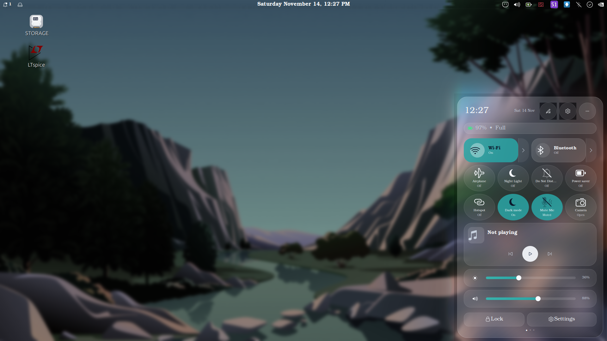

# ColorOS-inspired Quick Settings for Cinnamon

A GTK3 quick-settings panel for Linux Mint/Cinnamon, redesigned around the supplied ColorOS/Android-style reference: rounded cards, circular icons, large media card, sliders, active-state surfaces, and a dark modern layout.

<p align="center">
  
</p>

> **Note:** If this README is at the root of the repository (`~/UltimateOS/README.md`), use `src="assets/quick-settings.png"`. If it is inside `~/UltimateOS/quick-settings-coloros/README.md`, keep `src="../assets/quick-settings.png"` as shown above.

## Backend strategy

The existing system backends are intentionally retained: NetworkManager/nmcli for Wi-Fi, BlueZ/bluetoothctl for Bluetooth, PipeWire/wpctl for audio, sysfs/brightnessctl for brightness, UPower for battery, playerctl for media, Redshift for night light, and the existing composite toggles. The main changes are the presentation layer (`panel.py`, `widgets.py`, `theme.py`).

## Install dependencies

```bash
sudo apt install python3-gi gir1.2-gtk-3.0 gir1.2-upowerglib-1.0 \
  network-manager bluez pipewire wireplumber playerctl redshift brightnessctl
